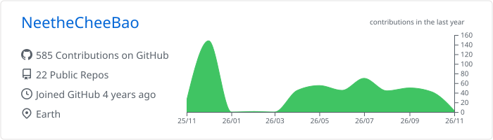
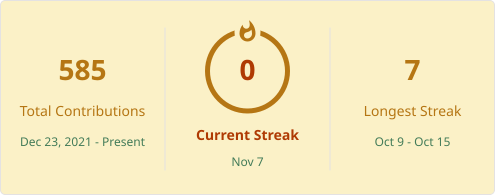

  

  
  
  
  
  
  
  

### 👤 About me

- Passionate about GUI and TUI software
- I like synthwave
- Astronomy enthusiast

 

 

Top languages

 

  

GitHub stats

 

  

Profile details

 

  

Contribution streak

 

  

Snake

 

  

Achievements

 
  <a href="https://github.com/NeetheCheeBao?tab=achievements">Achievements</a>

### 🌐 Blog

### ☎️ Connect

 

---

  

   

  

